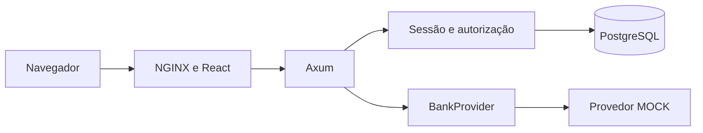

# Arquitetura e decisões

O navegador acessa frontend e API na mesma origem. O proxy entrega os arquivos compilados e encaminha /api. O servidor resolve a empresa a partir da sessão e consulta os perfis a cada requisição. O adaptador bancário recebe a empresa resolvida. Na Fase 1, todas as empresas visualizam a mesma série sintética identificada como MOCK. Eventos de auditoria vêm do banco local e são filtrados pela empresa da sessão.

## Fluxo de autenticação

1. O middleware compara a origem exata e exige o cabeçalho de requisição nas operações POST.
2. O login limita o tamanho da entrada e a concorrência de Argon2id. Uma transação bloqueia a linha da conta para serializar tentativas concorrentes. Contas desconhecidas passam por verificação de hash de custo equivalente.
3. Após verificar a senha, o servidor gera um identificador opaco aleatório, grava seu SHA-256 e o evento de acesso na mesma transação e entrega o cookie HttpOnly e SameSite=Strict. Produção exige cookie Secure.
4. O logout remove o digest e registra o evento atomicamente. Sessões expiram em oito horas. O servidor valida a expiração mesmo antes da coleta de registros antigos.

## Decisões registradas

- Centavos inteiros assinados no domínio e bigint no PostgreSQL. O fixture cabe na faixa inteira segura do JavaScript. Antes de expor bigint arbitrário, serializar centavos como string e validar os limites do contrato.
- Datas de competência permanecem datas civis. Eventos usam timestamptz e são apresentados em America/Fortaleza. O fluxo de caixa soma lançamentos liquidados a um saldo de abertura conhecido.
- A interface separa o extrato de demonstração da auditoria local. O modo de execução é validado ainda na inicialização, antes de abrir a conexão de banco.
- SQLx Core e o driver PostgreSQL são fixados na mesma versão. Essa seleção evita dependências de drivers opcionais sem uso no produto. As migrações são lidas do diretório migrations na inicialização e empacotadas no contêiner.
- A regra de separação entre aprovador e criador já possui constraint composta na estrutura de dados. A liberação de pagamentos ainda depende do fluxo de negócio, MFA, limites e reconciliação da Fase 4.
- Segredos locais são arquivos isolados por diretório com modo 0700. A instância do banco e o inicializador recebem segredos diferentes. A API persistente recebe somente a senha de sua role PostgreSQL.
- O adaptador de leitura da Fase 2 usa Reqwest com Rustls, seleção fixa de hosts por ambiente e identidade mTLS por integração. O contrato de leitura do painel fica separado dos contratos assíncronos de cobrança e pagamento.
